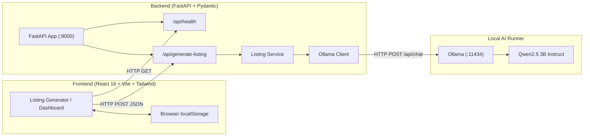

# ListingCraft AI 🛍️⚡

> **Local Open-Source E-Commerce Product Listing Generator**  
> Turn basic product details and notes into high-converting, platform-optimized product listings using local open-weight AI (**Qwen2.5 3B** via **Ollama**). Zero paid APIs. Zero cloud tracking. 100% privacy.

---

## 1. Project Overview

**ListingCraft AI** is a full-stack SaaS-grade application built for small business owners, online sellers, resellers, and handmade-craft creators. Creating compelling, SEO-rich product listings for platforms like Amazon, Etsy, and Shopify is time-consuming and often requires expensive monthly copywriter subscriptions.

ListingCraft AI solves this by deploying an open-weight instruction model locally to instantly generate:
- **SEO-optimized titles** tailored to platform character limits.
- **Alternative title variations** for A/B testing and split campaigns.
- **Conversion-focused product descriptions** (short marketplace excerpt + full markdown copy).
- **Formatted key selling points** (Amazon-style bracketed benefits, Etsy artisanal craftsmanship bullets).
- **High-intent search keywords & marketplace tags**.
- **Clear calls to action (CTA)**.
- **Listing Quality Score (0–100)** with real-time audit of SEO, readability, and persuasiveness.
- **Actionable improvement suggestions** to enhance conversions.

---

## 2. Problem Statement

Small merchants face three main obstacles when drafting product listings:
1. **Formatting Complexity:** Amazon demands keyword-heavy titles and standardized feature bullets; Etsy requires storytelling and 13 short search tags; Shopify demands brand-centric, lifestyle-driven copy.
2. **Cost & Privacy Concerns:** Cloud AI tools (ChatGPT Plus, Jasper, Copy.ai) charge \$20–\$50/month and send unreleased product ideas and proprietary supplier notes to remote servers.
3. **Hallucination Risks:** Generic AI prompts frequently invent false certifications (e.g. FDA approved), unverified warranties, or exaggerated medical claims that can get seller accounts suspended.

ListingCraft AI solves these challenges with tailored platform prompts, strictly bounded ethical copywriting, and completely local AI inference.

---

## 3. Main Features

- 🏢 **Platform-Specific Presets:**
  - **Amazon:** 120–180 character titles, 5 capitalized feature bullets `[BENEFIT] Details...`, promotional claim filtering.
  - **Etsy:** Artisan, warmth, craftsmanship, gift persona angles, and 13 concise search tags.
  - **Shopify / D2C:** Lifestyle narrative, structured markdown headers, and brand-first tone.
  - **Generic Marketplace:** Clean, balanced e-commerce copy for eBay, Walmart, or custom shops.
- 🎯 **Tone & Length Customization:**
  - 5 voice tones: *Professional, Friendly, Persuasive, Luxury, Minimal*.
  - 3 title length categories: *Short (<80 chars), Medium (80–140 chars), Long (140–200 chars)*.
  - Optional brand name, target audience, negative keywords to avoid, and custom keywords to include.
- 📊 **Listing Quality Score:**
  - Instant 0–100 rating with visual meters for **SEO Search**, **Readability**, and **Persuasion**.
  - Actionable suggestions for product photography, dimensions, and keyword improvements.
- 🛠️ **Results Workspace:**
  - **One-Click Copy:** Copy individual sections or the entire formatted listing.
  - **Inline Editing:** Edit any title, bullet point, or description before saving.
  - **Section Regeneration:** Re-roll individual sections (title, bullets, CTA) on the fly.
  - **Exporting:** Download listings as standalone `.md` (Markdown) or `.txt` (Plain Text) files.
- 📚 **Saved Listings Library:**
  - Stored locally in browser `localStorage`.
  - Search by product name, keywords, or title.
  - Filter by platform (Amazon, Etsy, Shopify, Generic).
  - Open, edit, duplicate, or delete listings with confirmation modals.
  - Bulk export as combined Markdown catalog or JSON backup.
- 🔒 **Privacy & Honest Fallback:**
  - Real-time diagnostic check of local Ollama daemon and model weights.
  - **Explicit DEMO MODE**: If Ollama is offline, users can test the full interface with realistic simulated generation labeled clearly as `DEMO MODE`—never masquerading as real AI.

---

## 4. Architecture & Data Flow



### Data Flow Steps
1. The user inputs product specifications on the React frontend.
2. The frontend sends a validated JSON payload to FastAPI (`POST /api/generate-listing`).
3. The backend formats an ethical system prompt tailored to the selected platform and sends a structured JSON inference request to Ollama (`http://localhost:11434/api/chat`).
4. Ollama runs **Qwen2.5 3B Instruct** locally.
5. The backend validates the structured response against Pydantic models, calculates the Listing Quality Score, and returns the formatted response.
6. The frontend renders the listing in the Results Workspace and allows saving to `localStorage`.

---

## 5. Technology Stack

### Frontend
- **Framework:** React 18
- **Build Tool:** Vite
- **Language:** TypeScript
- **Styling:** Tailwind CSS (Indigo/Violet SaaS design palette)
- **Icons:** Lucide React
- **Storage:** Browser `localStorage` (no account/cloud database needed)

### Backend
- **Framework:** FastAPI (Python 3.11+)
- **Validation:** Pydantic v2 & Pydantic Settings
- **HTTP Client:** HTTPX (async client for Ollama API)
- **Server:** Uvicorn
- **Testing:** Pytest & Pytest-Asyncio

### AI Engine
- **Runner:** Ollama (open-source local model server)
- **Model:** Qwen2.5 3B Instruct (`qwen2.5:3b`)
- **Mode:** Local inference without external API keys or cloud dependencies

---

## 6. Prerequisites

Ensure you have the following installed on your machine:
- **Node.js** (v18.0.0 or higher) and **npm**
- **Python** (v3.11 or higher)
- **Ollama** (optional for Demo Mode, required for real local AI generation): [Download Ollama](https://ollama.com)

---

## 7. Installation & Setup

### Step 1: Clone or Navigate to the Repository
```bash
git clone https://github.com/your-username/ListingCraft-AI.git
cd ListingCraft-AI
```

### Step 2: Set Up Backend

1. Navigate to the `backend/` directory:
   ```bash
   cd backend
   ```

2. Create a virtual environment:
   ```bash
   # Windows (PowerShell)
   python -m venv venv
   .\venv\Scripts\activate

   # macOS / Linux
   python3 -m venv venv
   source venv/bin/activate
   ```

3. Install dependencies:
   ```bash
   pip install -r requirements.txt
   ```

4. Configure environment variables (optional, defaults work out-of-the-box):
   ```bash
   cp .env.example .env
   ```

### Step 3: Set Up Frontend

1. Open a new terminal and navigate to `frontend/`:
   ```bash
   cd frontend
   ```

2. Install dependencies:
   ```bash
   npm install
   ```

3. Configure environment file:
   ```bash
   cp .env.example .env
   ```

---

## 8. Ollama Local AI Setup (For Real AI Inference)

1. **Install Ollama:**
   - Download the installer for Windows, macOS, or Linux from [ollama.com](https://ollama.com/download).

2. **Start Ollama Service:**
   ```bash
   ollama serve
   ```

3. **Pull the Recommended Model:**
   ```bash
   ollama run qwen2.5:3b
   ```
   *(ListingCraft AI also works with `llama3.2:3b`, `mistral`, or any other instruction model by changing `OLLAMA_MODEL` in `backend/.env`)*.

> **Note on Demo Mode:** If you do not have Ollama installed or want to run automated tests quickly, ListingCraft AI provides an **explicit DEMO MODE** toggle in the generator form that simulates full e-commerce generation with zero setup.

---

## 9. Running the Application

### 1. Launch Backend API
In your backend terminal (with venv activated):
```bash
# Windows
.\venv\Scripts\python -m uvicorn app.main:app --host 127.0.0.1 --port 8000 --reload

# Linux/macOS
python -m uvicorn app.main:app --host 127.0.0.1 --port 8000 --reload
```
The API documentation will be available at:
- **Interactive Swagger UI:** [http://127.0.0.1:8000/docs](http://127.0.0.1:8000/docs)
- **Health Endpoint:** [http://127.0.0.1:8000/api/health](http://127.0.0.1:8000/api/health)

### 2. Launch Frontend Application
In your frontend terminal:
```bash
cd frontend
npm run dev
```
Open your browser at:
- **Web App:** [http://localhost:5173](http://localhost:5173)

---

## 10. API Documentation

### `GET /api/health`
Checks backend health and queries Ollama connectivity and model availability.
**Response:**
```json
{
  "status": "healthy",
  "ollama_connected": true,
  "model_available": true,
  "model_name": "qwen2.5:3b",
  "available_models": ["qwen2.5:3b"],
  "message": "Ollama is online and model 'qwen2.5:3b' is ready.",
  "setup_guidance": null
}
```

### `POST /api/generate-listing`
Generates a complete, structured product listing.
**Request Body:**
```json
{
  "product_name": "Handmade Ceramic Coffee Mug",
  "category": "Kitchen & Dining",
  "description": "14oz handcrafted speckled stoneware mug with ergonomic thumb rest.",
  "platform": "etsy",
  "target_audience": "Coffee and pottery lovers",
  "brand_name": "StudioKiln",
  "features": ["14oz capacity", "Dishwasher safe", "Stoneware clay"],
  "tone": "friendly",
  "language": "English",
  "keywords_to_include": ["ceramic mug", "coffee lover gift"],
  "words_to_avoid": ["cheap", "mass-produced"],
  "desired_title_length": "medium",
  "demo_mode": false
}
```

### `POST /api/regenerate-section`
Regenerates an individual section (e.g. `title`, `selling_points`, `short_description`).
**Request Body:**
```json
{
  "section": "title",
  "context": { ...listing_generation_request... },
  "current_value": "Current title string"
}
```

---

## 11. Testing & Verification

### Running Backend Pytest Suite
Automated backend tests mock external Ollama calls, testing health endpoints, validation, error handling, and JSON repair logic:
```bash
# From workspace root
backend\venv\Scripts\pytest backend\tests -v
```
All 10 tests execute and pass:
```
backend/tests/test_health.py::test_root_endpoint PASSED
backend/tests/test_health.py::test_health_ollama_offline PASSED
backend/tests/test_health.py::test_health_ollama_online_and_model_ready PASSED
backend/tests/test_listings.py::test_input_validation_missing_required PASSED
backend/tests/test_listings.py::test_input_validation_invalid_platform PASSED
backend/tests/test_listings.py::test_demo_mode_generation PASSED
backend/tests/test_listings.py::test_real_ai_generation_success PASSED
backend/tests/test_listings.py::test_ollama_service_unavailable PASSED
backend/tests/test_listings.py::test_ollama_model_not_found PASSED
backend/tests/test_listings.py::test_regenerate_section_demo_mode PASSED
======================== 10 passed in 0.96s ========================
```

### Running Frontend Production Build & Linter
```bash
cd frontend
npm run lint
npm run build
```
Build output produces optimized bundles in `frontend/dist/`.

---

## 12. Troubleshooting

| Issue | Cause | Solution |
| :--- | :--- | :--- |
| **"Cannot connect to Ollama at http://localhost:11434"** | Ollama daemon is not running | Run `ollama serve` in a terminal, or enable **Demo Mode** in the generator form. |
| **"Model 'qwen2.5:3b' not found"** | Model weights have not been pulled | Run `ollama run qwen2.5:3b` once in terminal to download weights (~1.9 GB). |
| **CORS error in browser console** | Backend CORS origin mismatch | Ensure backend is running with default settings permitting `http://localhost:5173`. |
| **FastAPI port 8000 already in use** | Another service using port 8000 | Change `BACKEND_PORT=8001` in `.env` and set `VITE_API_BASE_URL=http://localhost:8001` in `frontend/.env`. |

---

## 13. Three-Minute Demo Walkthrough

1. **Explore the Landing Page (0:30):**
   - Open [http://localhost:5173](http://localhost:5173).
   - Review the value proposition, realistic preview card, 3-step workflow, and Local AI privacy guarantee.
   - Click **"Create My Listing"**.

2. **Generate a Product Listing (1:00):**
   - Click one of the quick demo buttons (e.g. **"Ceramic Mug"** or **"Keyboard"**) to automatically fill the form.
   - Select the target platform (e.g. **Amazon** or **Etsy**).
   - If Ollama is running, generate with real local AI; if offline, toggle **Demo Mode** on.
   - Click **"Generate Product Listing"**.

3. **Interact with the Results Workspace (1:00):**
   - Inspect the **Listing Quality Score** (SEO, Readability, Persuasion audit).
   - Review the platform-formatted Primary Title and 3 alternative variations.
   - Click **"Copy"** on any section to test the Clipboard API.
   - Click the pencil icon on the Title or Description to test inline editing.
   - Click **"Save Listing"** to persist it to your browser.
   - Click **".MD"** or **".TXT"** to test file export.

4. **Review Saved Library & Settings (0:30):**
   - Click **"Saved Listings"** in the top navigation to view the library card grid.
   - Test the live search bar and platform filter pills (Amazon/Etsy).
   - Test the **Duplicate** and **Delete** actions.
   - Visit the **Settings** tab to observe real-time Ollama status diagnostics and data management options.

---

## 14. License & Open Source

This project is licensed under the [MIT License](LICENSE). Built for makers, e-commerce sellers, and developers exploring local open-weight AI.
